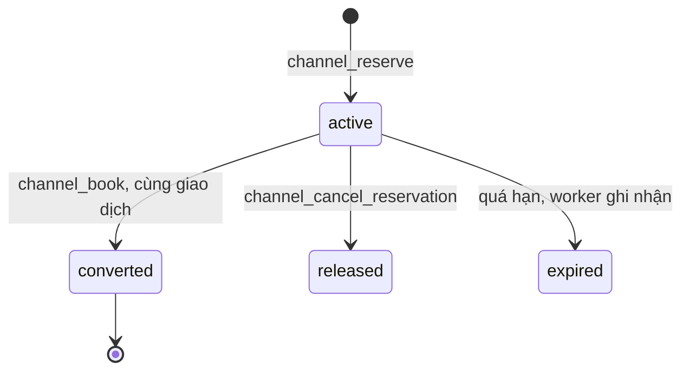
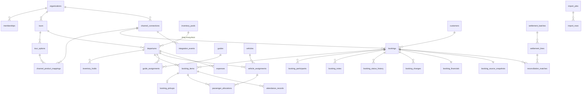

# Kiến trúc

```text
Trình duyệt (apps/admin)                Kênh bán (chưa kết nối thật)
   │  JWT người dùng                       │  Cổng HTTP tương lai, service_role
   ▼                                       ▼
PostgREST ──► RLS + RPC trong PostgreSQL ◄─┘
                     ▲
                     │  worker_* (kết nối thẳng)
              services/tour-worker
```

Nguyên khối, phân module rõ. Quyền kiểm tra ở database: ẩn nút trên giao diện chỉ là trải nghiệm.

## Đa doanh nghiệp

Bảng nghiệp vụ có `organization_id` và `UNIQUE (organization_id, id)`. Bảng con trỏ bằng FK hai cột, nên database chặn liên kết chéo doanh nghiệp. Bản đầu có trải nghiệm cho một doanh nghiệp; header đổi được nếu tài khoản thuộc nhiều nơi.

## Phân quyền

Quyền theo dạng `resource.action`, gom thành 7 vai trò. Mỗi thành viên có thể được cấp thêm hoặc thu hồi riêng. `has_org_permission` được gọi trong mọi policy và RPC.

Hướng dẫn viên chỉ có `guide.portal`: không đọc được bảng booking, đi qua `guide_my_departures` và `guide_manifest`, vốn kiểm tra đúng chuyến được giao và không trả cột tiền.

## Tồn chỗ

```text
chỗ còn bán = capacity - blocked_seats - tổng committed_seats - tổng hold còn hạn
```

Tính trên `inventory_pools`. Nhiều chuyến có thể dùng chung một nguồn chỗ.

Mọi đường đổi chỗ đi qua `_place_item`, dưới khóa `_lock_pools` theo thứ tự id. `committed_seats = 0` khi hủy, nên hủy lặp không trả chỗ hai lần.



## Sự kiện kênh

`ingest_channel_event` lưu sự kiện với khóa `(doanh nghiệp, kết nối, event_key)`, rồi xử lý ngay trong cùng giao dịch.

| Tình huống | Kết quả |
|---|---|
| Gửi lại cùng sự kiện | Trả kết quả cũ, tăng `duplicate_count` |
| Phiên bản hoặc thời điểm cũ hơn | `ignored_stale`, dữ liệu mới giữ nguyên |
| Nguồn không cho thứ tự | Vẫn áp dụng, `ordering_verified = false` để đối chiếu |
| Hủy đến trước tạo | `failed`, thử lại sau; không tạo booking rỗng |
| Payload sai | `dead`, xử lý tay, không thử lại vô ích |
| Lỗi tạm thời | Backoff 30s nhân đôi có jitter, tối đa 1 giờ, 6 lần |

## Trạng thái booking

Sáu trạng thái tách riêng: của kênh (`channel_status`), chuẩn hóa (`status`), điều hành (`ops_status`), thanh toán, đối soát, đồng bộ.

`ops_status` do `_recompute_booking_ops` suy ra, không ai đặt tay:

```text
cancelled → needs_mapping → needs_departure → needs_info → done / assigned / ready
```

## Sơ đồ quan hệ chính



Khác tên so với đặc tả: `users` là `profiles` (gắn `auth.users`); `roles/permissions` là `roles`, `permissions`, `role_permissions`.

## Worker

| Tác vụ | Chu kỳ | Việc |
|---|---|---|
| outbox | 5 giây | Sinh thông báo, ghi việc đẩy tình trạng chỗ |
| expire_holds | 15 giây | Đổi hold quá hạn thành `expired` |
| retry_events | 15 giây | Chạy lại sự kiện `failed` đến hạn |
| mark_stale | 1 phút | Kết nối thật lâu không liên lạc: booking thành "có thể đã cũ" |
| purge_payloads | 6 giờ | Xóa payload quá hạn lưu giữ |

`SKIP LOCKED` cho phép chạy nhiều bản. Với kết nối mock, việc đẩy tình trạng chỗ chỉ ghi `simulated`; với kết nối thật ghi `needs_connector`, không có request nào đi ra.

Hạn chế của hàng đợi PostgreSQL: độ trễ bằng chu kỳ thăm dò, và lưu lượng rất lớn đè lên database. Đổi sang Redis/BullMQ chỉ cần thay `tasks.ts`.
